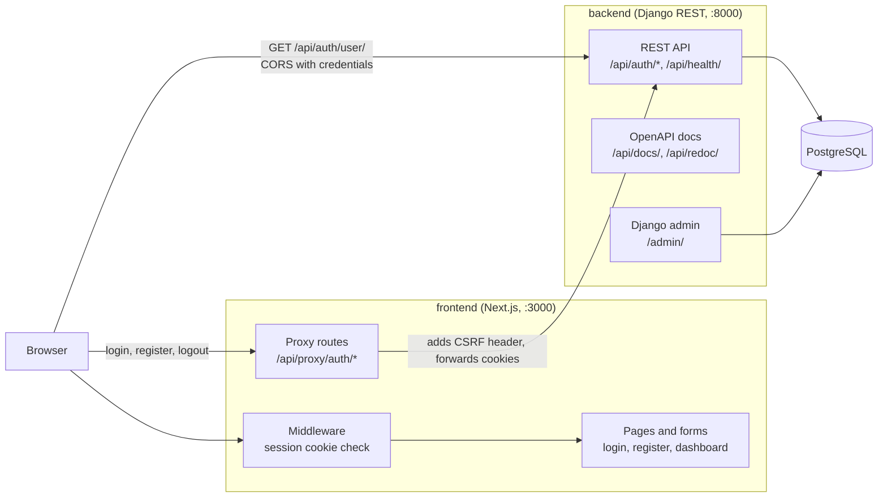

# dj-next

A full-stack authentication starter: a **Django REST** API that owns users and sessions, and a **Next.js** app that provides the sign-up, login and protected-page UI on top of it.

The two apps live in one repository and are developed together, but they run as separate processes and talk to each other over HTTP.

## Overview

The project covers the part of an application that almost every product needs first: letting people register, sign in, stay signed in, and reach pages that only signed-in users can see. It uses **cookie-based sessions with CSRF protection** rather than tokens kept in browser storage.

It is an early-stage foundation, not a finished product. There are no domain features yet beyond authentication (see [Project status](#project-status)).

## Technology stack

| Area | Technology | Role |
|---|---|---|
| Backend | Django 5.2, Django REST Framework | API and user model |
| Backend | dj-rest-auth, django-allauth | Login, logout, registration, password endpoints |
| Backend | drf-spectacular | OpenAPI schema, Swagger UI and ReDoc |
| Backend | django-cors-headers | CORS with credentials for the frontend origin |
| Backend | PostgreSQL 15 | Database |
| Backend | Poetry, [rav](https://pypi.org/project/rav/) | Dependencies and project task runner |
| Backend | pytest, Ruff, mypy | Tests, linting/formatting, strict type checking |
| Frontend | Next.js 15 (App Router), React 19, TypeScript | UI, routing, server-side proxy routes |
| Frontend | Tailwind CSS 4, shadcn/ui (Radix) | Styling and components |
| Frontend | TanStack Form, Zod | Form handling and validation |
| Frontend | pnpm, ESLint, Prettier | Dependencies and code quality |

## Features

Implemented:

- Email-based registration, login and logout.
- Session cookie authentication with CSRF protection (`HttpOnly`, `SameSite=Lax` cookies).
- Custom `User` model with a UUID primary key and email as the login field.
- Next.js proxy routes (`/api/proxy/auth/*`) that forward auth requests to Django, adding the CSRF header and passing the cookies back to the browser.
- Route protection in Next.js middleware: `/dashboard` requires a session cookie, and signed-in users are redirected away from `/login` and `/register`.
- Client-side auth context that loads the current user from `/api/auth/user/`.
- Form validation with Zod (including password strength rules on registration).
- Health check endpoint, OpenAPI schema, Swagger UI and ReDoc.
- Django admin for the custom user model.

Present in the code but not usable yet:

- Social login: the Google and Facebook buttons are placeholders that show an alert.
- Password reset, password change and email verification endpoints come with dj-rest-auth and are exposed by the API, but the frontend has no pages for them. Email is sent to the console only.
- A `UserProfile` model (avatar, bio) exists but is not exposed through the API.
- The login form links to `/forgot-password`, and the navigation links to `/profile`. Neither page exists.

## Architecture



How a login works:

1. The browser submits the login form to `/api/proxy/auth/login` on the Next.js server.
2. The proxy calls `POST /api/auth/login/` on Django, sending the `csrftoken` cookie value as `X-CSRFToken`.
3. Django authenticates the user and replies with `sessionid` and `csrftoken` cookies, which the proxy passes on to the browser.
4. Middleware sees the `sessionid` cookie and allows access to `/dashboard`. The client calls `/api/auth/user/` directly (cross-origin, with credentials) to load the user for the navigation bar.

## Project structure

```text
.
├── backend/                  Django project (Poetry)
│   ├── backend/              Django source root (manage.py)
│   │   ├── config/           Settings, root URLs, ASGI/WSGI
│   │   ├── accounts/         Custom User model, admin, service functions, tests
│   │   ├── api/              URL routing, health check, CSRF endpoint
│   │   ├── core/             wait_for_db management command
│   │   └── .env.example      Environment template
│   ├── pyproject.toml        Dependencies and Ruff/mypy/pytest configuration
│   └── rav.yaml              Task definitions (dev server, DB, lint, test)
├── frontend/                 Next.js app (pnpm)
│   ├── src/app/              Routes: (auth) login/register, (private) dashboard,
│   │                         (public) about, api/proxy/auth/* route handlers
│   ├── src/components/       UI primitives, form components, nav bar, auth buttons
│   ├── src/context/          Auth context (current user)
│   ├── src/middleware.ts     Redirects based on the session cookie
│   └── .env.example          Environment template
└── .github/workflows/        Frontend CI (lint, Prettier, type check)
```

## Prerequisites

- Python 3.11 or newer and [Poetry](https://python-poetry.org/) 2.x
- Node.js 20 or newer and [pnpm](https://pnpm.io/) 10
- PostgreSQL 15. The simplest route is Docker, which the `reset-db` task uses; any other PostgreSQL instance works if you point the environment variables at it.

Versions used while preparing this repository: Python 3.11.9, Poetry 2.1, Node.js 24, pnpm 10.28 and the `postgres:15` Docker image.

## Getting started

Clone the repository (replace the URL with your own):

```bash
git clone <repository-url> dj-next
cd dj-next
```

### 1. Backend

```bash
cd backend
poetry install --no-root
cp backend/.env.example backend/.env
```

Edit `backend/.env` and set a real `SECRET_KEY`. You can generate one with:

```bash
poetry run python -c "from django.core.management.utils import get_random_secret_key as k; print(k())"
```

Start PostgreSQL, apply migrations and run the server:

```bash
poetry run rav run reset-db   # starts a postgres:15 container named kbackend-db on port 5432
poetry run rav run migrate
poetry run rav run dev        # waits for the database, then serves http://localhost:8000
```

`reset-db` removes any existing container named `kbackend-db` before creating a new one, and it uses the credentials from `.env.example`. If port 5432 is already taken by another PostgreSQL, use that instance instead and adjust the `POSTGRES_*` values in `.env`.

Optionally create an admin user with `poetry run rav run superuser`.

Check that the API is up: <http://localhost:8000/api/health/> should return `{"status":"ok"}`. Interactive docs are at <http://localhost:8000/api/docs/>.

### 2. Frontend

In a second terminal:

```bash
cd frontend
pnpm install
cp .env.example .env.local
pnpm dev                      # http://localhost:3000
```

### Running everything

Run the backend (step 1) and the frontend (step 2) side by side, then open <http://localhost:3000>. There is no single command that starts both.

## Environment variables

**Backend**: `backend/backend/.env` (see [`.env.example`](backend/backend/.env.example))

| Variable | Description |
|---|---|
| `SECRET_KEY` | Django secret key. Required. |
| `DEBUG` | `True` for local development. Defaults to `False`. |
| `ALLOWED_HOSTS` | Comma-separated host names. |
| `POSTGRES_DB`, `POSTGRES_USER`, `POSTGRES_PASSWORD` | Database credentials. Required. |
| `POSTGRES_HOST`, `POSTGRES_PORT` | Database address. Required. |
| `DB_WAIT_RETRIES`, `DB_WAIT_DELAY` | Optional tuning for `wait_for_db` (defaults: 30 retries, 2 seconds). |

**Frontend**: `frontend/.env.local` (see [`.env.example`](frontend/.env.example))

| Variable | Description |
|---|---|
| `NEXT_PUBLIC_BACKEND_URL` | Base URL of the Django API, e.g. `http://localhost:8000`. It is inlined at build time, so rebuild after changing it. |

The CORS and CSRF allow-lists are currently hard-coded in `backend/backend/config/settings.py` (`http://localhost:3000`, plus a placeholder `https://your-app.vercel.app`). Update them for any other frontend origin.

## Available scripts

**Backend** (from `backend/`, run as `poetry run rav run <task>`):

| Task | What it does |
|---|---|
| `dev` | Waits for the database and starts the development server |
| `migrate`, `makemigrations` | Apply or create migrations |
| `test` | Run the pytest suite |
| `lint`, `lint:fix` | Ruff checks (`lint:fix` also applies fixes) |
| `format` | Ruff formatter |
| `type-check` | mypy in strict mode |
| `check` | `lint`, `type-check` and `test` in sequence |
| `reset-db` | Recreate the local PostgreSQL container |
| `health` | `curl` the health endpoint |

See [`backend/rav.yaml`](backend/rav.yaml) for the full list of tasks.

**Frontend** (from `frontend/`):

| Script | What it does |
|---|---|
| `pnpm dev` | Development server |
| `pnpm build`, `pnpm start` | Production build and server |
| `pnpm lint` | ESLint (`next lint`) |
| `pnpm type-check` | `tsc --noEmit` |
| `pnpm format` | Prettier, writing changes |

## Testing and verification

Backend tests need a running PostgreSQL, because pytest-django creates a temporary test database. With the database from the steps above running:

```bash
cd backend
poetry run rav run check
```

This runs Ruff, mypy and the pytest suite (10 tests covering the user model, the service functions, the admin and the `wait_for_db` command).

The frontend has no automated tests. Its checks are:

```bash
cd frontend
pnpm lint
pnpm exec prettier --check .
pnpm type-check
pnpm build
```

The GitHub Actions workflow in `.github/workflows/frontend-ci.yml` runs lint, the Prettier check and the type check for changes under `frontend/`. There is no backend CI workflow yet.

While preparing this repository, all of the commands above passed locally, and registration, login and the protected dashboard were exercised end to end through the Next.js proxy against a real Django and PostgreSQL instance.

## Project status

Early-stage prototype. The authentication flow works end to end, but the project is a starting point rather than a production-ready application.

Known limitations:

- No frontend tests, and no backend tests for the API endpoints themselves.
- Social login, password reset pages and a profile page are not implemented (see [Features](#features)).
- The dashboard page prints the raw session cookie value. This is a development aid and should be removed before real use.
- The default page title is still "Create Next App", and `get-user-client.ts` contains debug `console.log` calls.
- Settings are development-oriented: console email backend, hard-coded CORS origins, no media or static file configuration, and no deployment setup.
- django-allauth reports a deprecation warning for `ACCOUNT_USERNAME_REQUIRED`.

## License

Released under the [MIT License](LICENSE).
